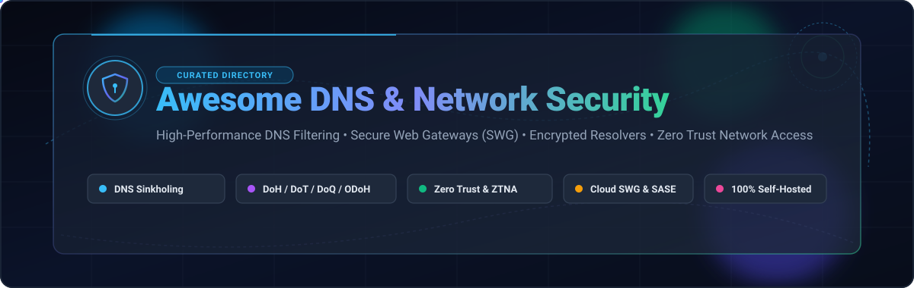

<p align="center">
  
</p>

<p align="center">
  <a href="https://github.com/ishandutta2007/Awesome-Awesome-Awesome"></a>
  <a href="https://discord.gg/jc4xtF58Ve"></a>
  <a href="https://github.com/ishandutta2007/Awesome-DNS-Network-Security/stargazers"></a>
  <a href="https://github.com/ishandutta2007/Awesome-DNS-Network-Security/network/members"></a>
  <a href="https://github.com/ishandutta2007/Awesome-DNS-Network-Security/blob/main/LICENSE"></a>
  <a href="https://github.com/ishandutta2007/Awesome-DNS-Network-Security/pulls"></a>
  <a href="https://github.com/ishandutta2007"></a>
</p>

---

# 🛡️ Awesome DNS & Network Security

> **A curated directory and reference architecture of Enterprise SaaS Platforms and Self-Hosted Open-Source Software for DNS Filtering, Secure Web Gateways (SWG), Encrypted Resolvers (DoH/DoT/DoQ), and Zero Trust Network Access (ZTNA).**

Whether protecting a multi-region corporate enterprise from phishing and malware exfiltration, or setting up a privacy-centric self-hosted DNS sinkhole for your home network, this repository categorizes the best tools available, with transparent pricing, free-tier limits, and architectural comparisons.

---

## 📑 Table of Contents

- [⚡ Quick Reference & TL;DR](#-quick-reference--tldr)
- [📈 Sector Overview & Market Dynamics](#-sector-overview--market-dynamics)
- [🏢 SaaS & Hosted Security Platforms](#-saas--hosted-security-platforms)
- [🔓 Open-Source GitHub Projects](#-open-source-github-projects)
- [🧩 Recommended Architecture Blueprints](#-recommended-architecture-blueprints)
- [⚖️ SaaS vs. Open-Source Decision Matrix](#️-saas-vs-open-source-decision-matrix)
- [🤝 How to Contribute](#-how-to-contribute)
- [⚠️ Disclaimer](#️-disclaimer)

---

## ⚡ Quick Reference & TL;DR

- **Need roaming laptop protection without running servers?** Cloud-delivered SASE / SWG solutions like [Cloudflare Zero Trust](#-saas--hosted-security-platforms) (generous 50-user free plan) or [Cisco Umbrella](#-saas--hosted-security-platforms) inspect traffic anywhere.
- **Want zero monthly bills & total network privacy?** Deploy [AdGuard Home](#-open-source-github-projects) or [Pi-hole](#-open-source-github-projects) on a Raspberry Pi or mini-PC to block ads, malicious domains, and telemetry across all IoT, mobile, and desktop devices.
- **Looking for Infrastructure-as-Code & ultra-low footprint?** Deploy [Blocky](#-open-source-github-projects) via Docker using declarative YAML configuration with ~15 MB RAM overhead.
- **Need multi-site clustering & authoritative zone management?** Deploy [Technitium DNS Server](#-open-source-github-projects).

---

## 📈 Sector Overview & Market Dynamics

The global **DNS Security Software and Secure Web Gateway (SWG)** market is currently estimated between **$16 Billion and $21 Billion** globally, accelerating rapidly as legacy appliance-based web proxies migrate to cloud-native Secure Access Service Edge (SASE) and Security Service Edge (SSE) architectures. Dedicated DNS security and filtering solutions expand at ~**9.2% CAGR**, while cloud-delivered SWG and Zero Trust platforms grow at **18% to 22% CAGR**, projected to exceed **$45 Billion** by the early 2030s.

### Market Concentration vs. Fragmentation
- **Cloud SWG & SASE (Highly Concentrated):** The enterprise perimeter is dominated by a concentrated group of cybersecurity heavyweights (Palo Alto Networks, Cisco, Cloudflare, and Zscaler). High infrastructure barrier-to-entry (global edge PoPs, low-latency BGP routing, and real-time SSL/TLS payload inspection) reinforces a "winner-take-most" dynamic for Global 2000 deployments.
- **DNS Filtering & Threat Detection (Moderately Fragmented):** The pure-play DNS security layer exhibits healthy, competitive fragmentation. Specialized innovators like DNSFilter, Control D, and NextDNS compete actively against incumbent telecom/enterprise providers by delivering AI categorization, transparent per-endpoint pricing, and multi-tenant MSP control panels.
- **Open-Source & Homelab Ecosystem (Vibrant & Decentralized):** A thriving open-source ecosystem (led by community staples like Pi-hole, AdGuard Home, and Blocky) empowers millions of self-hosters and privacy advocates to enforce network-wide telemetry shielding without commercial vendor lock-in.

---

## 🏢 SaaS & Hosted Security Platforms

The following hosted SaaS solutions provide managed DNS threat blocking, cloud-delivered Secure Web Gateways (SWG), and Zero Trust access policies.

> **Sorted by Company Scale (Valuation / Market Cap) Descending**

| 🏢 Provider & Solution | 💰 Company Scale (Valuation / Cap) | 💵 Starting Price | 🎁 Free Tier & Trial Limits | 🛡️ Core Capabilities | 🎯 Best For |
| :--- | :--- | :--- | :--- | :--- | :--- |
| **[Cisco Umbrella](https://umbrella.cisco.com/)** | **~$225 Billion** *(Market Cap; $54B Ann. Rev)* | **$2.25 / user / month** *(DNS Security Essentials, billed annually at ~$27/user/yr)* | **14-day free trial** with full DNS threat protection; no permanent free tier. | DNS-layer threat protection, intelligent proxy, SWG, cloud firewall, CASB, Cisco Talos threat intelligence. | Large enterprises requiring deep Cisco SD-WAN and AnyConnect integration. |
| **[Palo Alto Prisma Access](https://www.paloaltonetworks.com/prisma/access)** | **~$120 Billion** *(Market Cap; $8.0B Ann. Rev)* | **$9.17 / user / month** *($110 / user / year SWG Edition list price)* | **14 to 30-day guided Proof of Concept (PoC)** upon enterprise sales request; no self-service free tier. | Cloud-delivered SASE, ZTNA 2.0, autonomous digital experience management (ADEM), next-gen CASB. | Large enterprises invested in the Palo Alto Networks and Strata NGFW ecosystem. |
| **[Cloudflare Zero Trust](https://www.cloudflare.com/zero-trust/)** | **~$32 Billion** *(Market Cap; $1.7B Ann. Rev)* | **$7.00 / user / month** *(Pay-as-you-go Plan, billed monthly)* | **Free forever up to 50 users** (includes Gateway DNS filtering, WARP client, 2 CASB integrations, 24-hr logs). | Zero Trust Network Access (ZTNA), secure DNS/HTTP gateway, WARP client, remote browser isolation (RBI). | Startups, SMBs, and distributed teams needing a generous free tier with low-latency edge PoPs. |
| **[Zscaler Internet Access (ZIA)](https://www.zscaler.com/)** | **~$27 Billion** *(Market Cap; $2.2B Ann. Rev)* | **$6.00 / user / month** *($72 / user / year entry tier for ZIA Cloud Security)* | **14 to 30-day enterprise Proof of Concept (PoC)** with custom traffic scoping; no public free tier. | Cloud-native SWG, inline full SSL/TLS inspection at scale, cloud sandbox, CASB, DLP. | Global enterprises executing legacy proxy replacement and secure remote work transformations. |
| **[Akamai Secure Internet Access](https://www.akamai.com/products/secure-internet-access-enterprise)** | **~$14 Billion** *(Market Cap; $3.9B Ann. Rev)* | **$3.50 / user / month** *(~$42 / user / year volume base via G-Cloud procurement)* | **30-day guided Proof of Concept (PoC)** with real-time Akamai threat intelligence feeds; no public free tier. | Recursive DNS threat defense, zero-day malware mitigation, payload analysis, Akamai global edge distribution. | Enterprises wanting carrier-grade recursive DNS defense backed by Akamai's global threat data. |
| **[Barracuda Content Shield](https://www.barracuda.com/products/network-protection/content-shield)** | **~$4.0 Billion** *(Valuation via KKR; $550M+ Ann. Rev)* | **$3.99 / user / month** *($47.88 / user / year for entry tier via software distributors)* | **30-day free trial** with full access to BCS Plus features, content filters, and endpoint agents; no permanent free tier. | Cloud-managed DNS filtering, category content blocking, lightweight roaming agents, Entra ID integration. | K-12 school districts, higher education, and mid-market organizations. |
| **[Infoblox BloxOne Threat Defense](https://www.infoblox.com/products/bloxone-threat-defense/)** | **~$3.4 Billion** *(Valuation via Vista / Warburg; $500M+ Ann. Rev)* | **$2.67 / user / month** *(~£25.18 / $32 / user / year base tier on G-Cloud)* | **90-day free evaluation period** (or 30-day lab PoC) with automated threat containment; no permanent free tier. | Hybrid on-prem/cloud DNS security, DDI integration (DNS/DHCP/IPAM), DNS tunneling and DGA detection. | Organizations requiring tight coordination between core IPAM/DDI services and DNS defense. |
| **[Forcepoint ONE](https://www.forcepoint.com/product/forcepoint-one)** | **~$1.2 Billion** *(Valuation via Francisco Partners; $450M Ann. Rev)* | **$2.42 / user / month** *(~£22.80 / $29 / user / year base web tier on G-Cloud)* | **30-day evaluation trial** with cloud web filtering, URL categorization, and DLP policies; no permanent free tier. | Unified SSE platform (SWG, CASB, ZTNA), inline behavioral data loss prevention (DLP), threat protection. | Government agencies, defense contractors, and strictly regulated enterprise environments. |
| **[DNSFilter](https://www.dnsfilter.com/)** | **~$150 Million** *(Valuation via Insight Partners; $25M+ ARR)* | **$1.00 / user / month** *($12 / user / year Core tier; $23/mo minimum account spend)* | **14-day free trial** (unlimited features and test queries, no credit card required); no permanent free tier. | AI-driven domain categorization (Webshrinker), roaming agent, multi-tenant MSP portal, API-first architecture. | Managed Service Providers (MSPs), IT service companies, and SMBs wanting fast DNS protection. |
| **[Control D](https://controld.com/)** | **~$30 Million** *(Valuation, Bootstrapped & Profitable; Windscribe sister co.)* | **$2.00 / endpoint / month** *(Business SMB tier) or $3.00 / month (Personal Some Control)* | **14-day full-feature free trial** (no credit card required); free public uncached DNS resolvers (uncustomized). | Encrypted DNS (DoH3, DoQ, DoT), multi-profile rules, geo-blocking, custom upstream forwarding, REST API. | Power users, homelabs, remote teams, and privacy-conscious SMBs wanting modern protocol support. |
| **[NextDNS](https://nextdns.io/)** | **~$25 Million** *(Valuation, Bootstrapped & Profitable; $7M+ ARR)* | **$1.99 / month** *($19.90 / year for Pro unlimited queries across all devices)* | **Free forever up to 300,000 queries / month** across unlimited devices (continues resolving unfiltered after cap). | Cloud DNS resolver, privacy blocklists, parental controls, AI threat intelligence, native DoH/DoT/DoQ. | Individuals, families, and micro-teams wanting a plug-and-play cloud alternative to Pi-hole. |

---

## 🔓 Open-Source GitHub Projects

The following open-source solutions provide self-hosted DNS sinkholing, recursive encrypted resolution, zero-trust overlay routing, and network threat mitigation without recurring license fees.

> **Sorted by GitHub Stars Descending** *(Click star badges to inspect live stargazer counts)*

### 1. 🕳️ [Pi-hole](https://github.com/pi-hole/pi-hole) [](https://github.com/pi-hole/pi-hole/stargazers)
- **License**: EUPL-1.2 | **Primary Language**: C / Shell / PHP
- **Overview**: The original and most widely deployed open-source network-wide ad blocker and DNS sinkhole. Protects every device connected to your LAN (smart TVs, IoT appliances, smartphones, consoles) without installing client software.
- **Key Features**:
  - **FTL Engine**: High-performance DNS resolver written in C capable of processing millions of queries efficiently.
  - **Gravity Blocklist Engine**: Pulls and deduplicates community ad, malware, and tracker lists automatically.
  - **Integrated DHCP Server**: Simplifies network deployment for routers lacking custom DNS server settings.
  - **Comprehensive Dashboard**: Real-time query log analysis, per-client telemetry, and domain blacklist/whitelist controls.
- **Architectural Note**: Lacks native DoH/DoT encryption; pair with **Unbound** or `cloudflared` for encrypted upstream resolution.
- **Best For**: Home networks, homelab builders, and small offices seeking the largest support community.

---

### 2. 🔐 [Tailscale](https://github.com/tailscale/tailscale) [](https://github.com/tailscale/tailscale/stargazers)
- **License**: BSD-3-Clause | **Primary Language**: Go
- **Overview**: Zero-config mesh VPN built on WireGuard with integrated **MagicDNS** that enables secure internal DNS resolution and encrypted split-tunnel routing across all your devices and servers.
- **Key Features**:
  - **MagicDNS**: Automatically assigns human-readable DNS names to devices in your tailnet with zero configuration.
  - **Split DNS Overrides**: Route specific corporate or internal domains through private DNS servers while sending public queries elsewhere.
  - **NextDNS / Pi-hole Integration**: Easily configure your entire mesh network to enforce centralized DNS filtering.
  - **Zero Trust ACLs**: Fine-grained role-based access control policies defining which nodes can communicate.
- **Best For**: Distributed teams, developers, and remote workers connecting securely without opening firewall ports.

---

### 3. 🛡️ [AdGuard Home](https://github.com/AdguardTeam/AdGuardHome) [](https://github.com/AdguardTeam/AdGuardHome/stargazers)
- **License**: GPL-3.0 | **Primary Language**: Go
- **Overview**: Modern network-wide ads and tracker blocking DNS server. Functions as an all-in-one DNS server with built-in encrypted protocol support (DoH, DoT, DoQ, and DNSCrypt) in a single standalone binary.
- **Key Features**:
  - **Native Encrypted DNS**: Acts as a DoH/DoT/DoQ server and upstream client out of the box without requiring sidecars.
  - **Per-Client Filtering Rules**: Assign different blocklists, parental controls, or SafeSearch requirements to specific IP addresses or MACs.
  - **Lightweight Footprint**: Written in Go with minimal resource utilization (~60–90 MB RAM under active load).
  - **DNS Rewrites & DHCP**: Built-in authoritative domain rewrites, custom upstream routing, and DHCP capabilities.
- **Best For**: Privacy enthusiasts and homelabs wanting native encrypted DNS and per-device rules in a polished UI.

---

### 4. 🌐 [NetBird](https://github.com/netbirdio/netbird) [](https://github.com/netbirdio/netbird/stargazers)
- **License**: BSD-3-Clause | **Primary Language**: Go
- **Overview**: Open-source Zero Trust mesh networking platform built on WireGuard with centralized DNS management, automated peer-to-peer NAT traversal, and identity provider integration.
- **Key Features**:
  - **Nameserver & Split DNS Management**: Distribute private DNS servers to endpoints with granular routing domains.
  - **IdP Integration**: Works natively with Keycloak, Okta, Microsoft Entra ID, and Google Workspace.
  - **Post-Quantum Security**: Implements quantum-resistant key exchange algorithms.
  - **Multi-Cloud Mesh**: Interconnect servers across AWS, GCP, Azure, and local bare-metal effortlessly.
- **Best For**: DevOps teams and enterprises seeking a 100% self-hostable open-source alternative to Tailscale.

---

### 5. 🚫 [HaGeZi DNS Blocklists](https://github.com/hagezi/dns-blocklists) [](https://github.com/hagezi/dns-blocklists/stargazers)
- **License**: CC-BY-SA-4.0 | **Primary Language**: Shell / Python
- **Overview**: The gold standard in curated, high-accuracy DNS blocklists. Provides layered protection tiers (Multi Light, Normal, Pro, Pro++, and Ultimate) with near-zero false positive rates.
- **Key Features**:
  - **Multi-Engine Formats**: Ready-to-use lists compiled for Pi-hole, AdGuard Home, Unbound, BIND, dnsmasq, and pfSense/OPNsense.
  - **Specialized Threat Feeds**: Dedicated blocklists for Dynamic DNS abuse, DoH bypass protection, malware domains, and telemetry.
  - **Daily Automated Audits**: Continuously tested and verified against legitimate top 1-million domains to prevent false blocks.
- **Best For**: Anyone running a self-hosted DNS filter looking for reliable, actively maintained domain blocklists.

---

### 6. ⚔️ [CrowdSec](https://github.com/crowdsecurity/crowdsec) [](https://github.com/crowdsecurity/crowdsec/stargazers)
- **License**: MIT | **Primary Language**: Go
- **Overview**: Open-source, collaborative intrusion prevention system (modern successor to Fail2ban). Detects hostile behavior across server logs, application events, and network packets, leveraging a global crowdsourced threat intelligence consensus.
- **Key Features**:
  - **Crowdsourced Threat Intel**: Automatically receives and blocks IP addresses identified as malicious by community peers.
  - **Remediation Bouncers**: Enforce blocks via firewall (iptables/nftables), Cloudflare API, Nginx, Traefik, or DNS sinkholes.
  - **DNS Query Attack Detection**: Detects DNS amplification, port scans, and brute-force access attempts.
- **Best For**: Infrastructure engineers needing automated, crowd-powered network perimeter defense.

---

### 7. 🔌 [CoreDNS](https://github.com/coredns/coredns) [](https://github.com/coredns/coredns/stargazers)
- **License**: Apache-2.0 | **Primary Language**: Go
- **Overview**: Cloud Native Computing Foundation (CNCF) graduated DNS server with a modular plugin architecture. Serves as the default service discovery DNS server for Kubernetes clusters worldwide.
- **Key Features**:
  - **Plugin Chaining Architecture**: Every DNS function (caching, logging, metrics, blocking, DNSSEC, rewrites) is handled by pluggable modules.
  - **Prometheus Metrics**: Deep native observability into query latency, upstream response codes, and cache hit ratios.
  - **Kubernetes Native**: Seamless discovery of pods, services, and external endpoints.
- **Best For**: Cloud-native architectures, container orchestration, and custom microservice DNS routing.

---

### 8. 🔒 [DNSCrypt Proxy](https://github.com/DNSCrypt/dnscrypt-proxy) [](https://github.com/DNSCrypt/dnscrypt-proxy/stargazers)
- **License**: ISC | **Primary Language**: Go
- **Overview**: Flexible client-side DNS proxy with comprehensive support for modern encrypted DNS protocols including DNSCrypt v2, Anonymized DNSCrypt, DNS-over-HTTPS (DoH), and Oblivious DoH (ODoH).
- **Key Features**:
  - **Anonymized DNS & Relays**: Routes encrypted DNS queries through intermediate relays to decouple client IP addresses from query contents.
  - **Local Filtering**: Built-in pattern blocking for domains, IP addresses, and specific query record types.
  - **DNS Cache & Load Balancing**: Queries multiple upstream resolvers simultaneously and automatically routes to the fastest healthy node.
- **Best For**: Privacy purists and endpoint defense requiring encrypted upstream queries with relay anonymization.

---

### 9. 🎛️ [Technitium DNS Server](https://github.com/TechnitiumSoftware/DnsServer) [](https://github.com/TechnitiumSoftware/DnsServer/stargazers)
- **License**: GPL-3.0 | **Primary Language**: C# (.NET)
- **Overview**: Full-featured authoritative and recursive DNS server with built-in ad/threat blocking and multi-server clustering. Engineered for enterprise and homelab networks needing comprehensive DNS management in one pane of glass.
- **Key Features**:
  - **Multi-Node Clustering**: Synchronize configurations, blocklists, and authoritative zones across multiple physical or virtual DNS servers.
  - **All-in-One Engine**: Authoritative zone hosting, recursive caching, DNS sinkholing, and DNSSEC validation in a single process.
  - **DNS-over-QUIC (DoQ)**: Native support for DoH, DoT, and DoQ upstream and client resolution.
  - **App Ecosystem**: Modular plugin apps for Advanced Forwarding, Split-Horizon DNS, DNS Rebinding Protection, and DNS64.
- **Best For**: Sysadmins and homelabbers running multi-site deployments who need clustering and authoritative zone control.

---

### 10. 🔥 [Firezone](https://github.com/firezone/firezone) [](https://github.com/firezone/firezone/stargazers)
- **License**: Apache-2.0 | **Primary Language**: Rust / Elixir
- **Overview**: Fast, open-source Zero Trust Network Access (ZTNA) platform built on WireGuard in Rust. Provides least-privilege remote access with granular DNS routing and native identity provider synchronization.
- **Key Features**:
  - **Granular Resource Access**: Grant users access to specific internal IPs, CIDRs, or FQDNs rather than the entire subnet.
  - **Split-Tunnel DNS**: Intercepts internal DNS queries while leaving consumer web traffic untouched.
  - **Enterprise IdP Sync**: SCIM and OIDC provisioning with Entra ID, Okta, and Google Workspace.
- **Best For**: Teams replacing legacy hardware VPNs with a modern, high-throughput Zero Trust gateway.

---

### 11. 📦 [Blocky](https://github.com/0xERR0R/blocky) [](https://github.com/0xERR0R/blocky/stargazers)
- **License**: Apache-2.0 | **Primary Language**: Go
- **Overview**: Ultra-fast, lightweight DNS proxy and ad-blocker designed specifically for local networks and Infrastructure-as-Code (IaC) environments.
- **Key Features**:
  - **Minimal Memory Usage**: Requires only ~10–25 MB RAM, making it optimal for ultra-constrained routers and VPS nodes.
  - **Config-as-Code**: 100% configured via a single declarative YAML file; perfectly suited for GitOps and Ansible.
  - **Native DoH & DoT**: Encrypted upstream queries without external helper daemons.
  - **Multi-Instance Sync**: Synchronize state across multiple Blocky replicas using Redis.
- **Best For**: DevOps engineers, GitOps practitioners, and minimalists who prefer YAML files over web UIs.

---

### 12. 🔄 [Unbound](https://github.com/NLnetLabs/unbound) [](https://github.com/NLnetLabs/unbound/stargazers)
- **License**: BSD-3-Clause | **Primary Language**: C
- **Overview**: High-security, validating, recursive, and caching DNS resolver designed by NLnet Labs. Commonly deployed as the upstream resolver behind Pi-hole or AdGuard Home to bypass third-party ISP upstream servers entirely.
- **Key Features**:
  - **True Recursive Resolution**: Queries root DNS servers directly (`.` -> `.com` -> `example.com`) without sharing data with intermediate commercial resolvers.
  - **Strict DNSSEC Validation**: Guarantees cryptographic authenticity of resolved DNS responses.
  - **Hardened C Codebase**: Battle-tested in enterprise production and national internet exchange infrastructure.
- **Best For**: Security engineers seeking independent, validating recursive DNS without commercial intermediaries.

---

### 13. 🚀 [MassDNS](https://github.com/blechschmidt/massdns) [](https://github.com/blechschmidt/massdns/stargazers)
- **License**: GPL-3.0 | **Primary Language**: C
- **Overview**: High-performance stub resolver capable of resolving millions of domain names concurrently. Capable of resolving over 350,000 queries per second using asynchronous epoll/sockets.
- **Key Features**:
  - **Extreme Throughput**: Resolves large domain lists and blocklists in seconds.
  - **Reconnaissance & Auditing**: Extensively utilized by red teams and network defenders to audit subdomains and authoritative records.
  - **Lightweight C**: Zero external runtime dependencies.
- **Best For**: Security researchers, bug bounty hunters, and network administrators benchmarking resolvers and blocklists.

---

### 14. 🔎 [dnsx](https://github.com/projectdiscovery/dnsx) [](https://github.com/projectdiscovery/dnsx/stargazers)
- **License**: MIT | **Primary Language**: Go
- **Overview**: Fast and multi-purpose DNS toolkit by ProjectDiscovery designed for running multiple DNS queries against lists of domains, verifying DNS wildcards, and extracting security records.
- **Key Features**:
  - **Automated Wildcard Filtering**: Detects and filters out DNS wildcard configurations automatically.
  - **Record Extraction**: Extracts A, AAAA, CNAME, PTR, MX, TXT, SRV, and SOA records simultaneously.
  - **JSON Telemetry Output**: Formatted output designed to integrate into automated security scanning pipelines.
- **Best For**: DevSecOps teams and security engineers validating enterprise DNS security postures.

---

### 15. 🌐 [DNS-over-HTTPS](https://github.com/m13253/dns-over-https) [](https://github.com/m13253/dns-over-https/stargazers)
- **License**: MIT | **Primary Language**: Go
- **Overview**: High-performance RFC 8484 DNS-over-HTTPS client and server implementation. Ideal for standing up a custom DoH endpoint or acting as an encrypted bridge between local network clients and public resolvers.
- **Key Features**:
  - **RFC 8484 Compliance**: Fully standard-compliant DoH server and client.
  - **EDNS0 Client Subnet (ECS)**: Configurable ECS forwarding to preserve geo-DNS accuracy.
  - **HTTP/2 & HTTP/3 Support**: Supports multiplexed DNS streams over modern web transports.
- **Best For**: System engineers setting up private DoH proxy gateways or hosting encrypted public resolvers.

---

### 16. 🔒 [Stubby](https://github.com/getdnsapi/stubby) [](https://github.com/getdnsapi/stubby/stargazers)
- **License**: BSD-3-Clause | **Primary Language**: C
- **Overview**: Local DNS Privacy stub resolver developed by the getdns project. Encrypts DNS queries sent from local client machines using DNS-over-TLS (DoT).
- **Key Features**:
  - **Strict Privacy Mode**: Enforces TLS certificate authentication and pinning to eliminate man-in-the-middle attacks.
  - **Round-Robin & Fallback**: Handles automated failover across privacy-respecting upstream resolvers.
  - **Low Footprint**: Tailored for installation on individual endpoints, laptops, and OpenWrt routers.
- **Best For**: Technical desktop and router users needing lightweight DoT encryption on endpoints.

---

### 17. 🛡️ [modDNS](https://github.com/ivpn/moddns) [](https://github.com/ivpn/moddns/stargazers)
- **License**: GPL-3.0 | **Primary Language**: Go / TypeScript
- **Overview**: Audited full-stack DNS security platform engineered by the IVPN team. Implements a modern microservices architecture providing customizable DNS filtering profiles and encrypted protocols.
- **Key Features**:
  - **Multi-Protocol Support**: Native DoH, DoT, and DoQ ingress and egress resolution.
  - **Profile Management**: WebAuthn/TOTP MFA-protected administration dashboard for managing per-device filter rules.
  - **Audited Architecture**: Independently security-audited codebase designed for multi-tenant privacy services.
- **Best For**: Organizations and VPN providers building auditable, multi-tenant DNS filtering infrastructure.

---

## 🧩 Recommended Architecture Blueprints

Combine these components into battle-tested architectures based on your network scale and privacy profile:

```
           +-----------------------------------------------------------+
           |                    Client Devices                         |
           |   (Workstations, Laptops, Mobile, IoT, Smart TVs)         |
           +-----------------------------+-----------------------------+
                                         |
                       Plain DNS / DoH / DoT Queries
                                         |
                                         v
           +-----------------------------------------------------------+
           |               Network-Wide Filter Layer                   |
           |             [AdGuard Home]  OR  [Pi-hole]                 |
           |   - Gravity / HaGeZi Blocklists                           |
           |   - Per-Client Filtering & SafeSearch                     |
           |   - Local Domain Rewrites & DNS Sinkholing                |
           +-----------------------------+-----------------------------+
                                         |
                     Validated Non-Blocked DNS Queries
                                         |
                                         v
           +-----------------------------------------------------------+
           |              Recursive Resolver & Cryptography            |
           |                     [Unbound Resolver]                    |
           |   - Strict DNSSEC Validation                              |
           |   - Direct Root & TLD Iteration (No commercial logs)      |
           +-----------------------------+-----------------------------+
                                         |
                     Authoritative Recursive Queries (Port 53)
                                         |
                                         v
           +-----------------------------------------------------------+
           |                  Root & TLD Nameservers                   |
           |             (. -> .com -> authoritative DNS)              |
           +-----------------------------------------------------------+
```

### 1. The Autonomous Privacy Stack *(Zero Commercial Intermediaries)*
- **Filter**: [AdGuard Home](https://github.com/AdguardTeam/AdGuardHome) or [Pi-hole](https://github.com/pi-hole/pi-hole)
- **Upstream Resolver**: [Unbound](https://github.com/NLnetLabs/unbound) running locally on port 5335
- **Blocklists**: [HaGeZi Multi PRO++](https://github.com/hagezi/dns-blocklists)
- **Outcome**: 100% of network devices protected against ads and trackers. Queries resolve directly against root DNS servers with cryptographic DNSSEC verification; zero DNS data sent to any corporate ISP or tech conglomerate.

### 2. The GitOps / Cloud-Native Stack
- **Ingress DNS**: [Blocky](https://github.com/0xERR0R/blocky) running as lightweight Docker containers synced via Redis
- **Overlay Mesh**: [Tailscale](https://github.com/tailscale/tailscale) or [NetBird](https://github.com/netbirdio/netbird) with Split MagicDNS
- **Intrusion Mitigation**: [CrowdSec](https://github.com/crowdsecurity/crowdsec)
- **Outcome**: Declarative infrastructure managed via Git commits. High availability across redundant nodes with automatic peer-to-peer mesh routing.

### 3. The Enterprise SASE Hybrid Stack
- **Roaming Users & Remote Work**: [Cloudflare Zero Trust](https://www.cloudflare.com/zero-trust/) or [Cisco Umbrella](https://umbrella.cisco.com/) client agents enforcing SWG and CASB policies off-premises.
- **HQ & Branch Offices**: [Infoblox BloxOne](https://www.infoblox.com/products/bloxone-threat-defense/) or [Technitium](https://github.com/TechnitiumSoftware/DnsServer) clusters handling local internal zone resolution and DHCP synchronization.

---

## ⚖️ SaaS vs. Open-Source Decision Matrix

| Dimension | 🏢 Enterprise SaaS (e.g. Cisco Umbrella, Cloudflare, Zscaler) | 🔓 Self-Hosted Open-Source (e.g. AdGuard Home, Pi-hole, Blocky) |
| :--- | :--- | :--- |
| **Data Privacy** | Queries are processed in vendor cloud datacenters; subject to vendor terms and compliance policies. | **100% Local**: No queries or browsing habits ever leave your self-hosted infrastructure. |
| **Roaming Protection** | **Native**: Mobile and laptop roaming clients enforce DNS policies anywhere on public Wi-Fi or LTE. | **Requires VPN**: Remote devices must route traffic back via WireGuard, Tailscale, or OpenVPN. |
| **Deployment Effort** | Low to medium: Cloud console sign-up and push-deployment of client agents via MDM. | Low to high: Requires dedicated local hardware (Raspberry Pi, mini-PC, VM, or Docker container). |
| **Total Cost of Ownership** | Billed per seat/month ($1.00 – $9.00+/user/month); recurring operational software expenditure. | **$0 in ongoing software fees**; minimal hardware and electricity expense. |
| **Advanced Inspection** | **Full SWG & DLP**: Deep SSL/TLS decryption, anti-malware sandboxing, CASB tenant restrictions. | **DNS-Layer Only**: Sinkholes malicious domains before TCP connection; cannot decrypt HTTPS body data. |

---

## 🤝 How to Contribute

We welcome contributions to expand this directory with high-quality SaaS tools and active open-source projects!

1. **Fork the Repository**: Click the `Fork` button at the top of this repo.
2. **Add or Update Entries**:
   - For SaaS tools: Include specific starting tier pricing, explicit free tier / trial limits, and company scale metrics in the table.
   - For Open-Source tools: Include repository link, license, features, and add the corresponding shields.io star badge linking to its `/stargazers` page.
3. **Keep Information Factual**: Base descriptions on official vendor technical documentation, G-Cloud procurement sheets, and official GitHub releases.
4. **Submit a Pull Request**: Provide a clear explanation of your additions or revisions.

---

## ⚠️ Disclaimer

- This curated list is maintained by the cybersecurity community for educational, research, and infrastructure defense purposes.
- Mentions of specific vendors or commercial trademarks do not constitute an endorsement.
- DNS and Secure Web Gateway tools intercept network telemetry; ensure your deployment complies with regional privacy regulations (such as GDPR, CCPA, and HIPAA) and organizational acceptable-use agreements.
- Misconfigured DNS resolvers can lead to network downtime or vulnerabilities like DNS amplification and rebinding. Always validate changes in a staging environment.

---

<p align="center">
  <b>⭐ Star this repository if it helps secure your network!</b><br/>
  <sub>Maintained for security engineers, network administrators, homelab builders, and privacy advocates worldwide.</sub>
</p>
